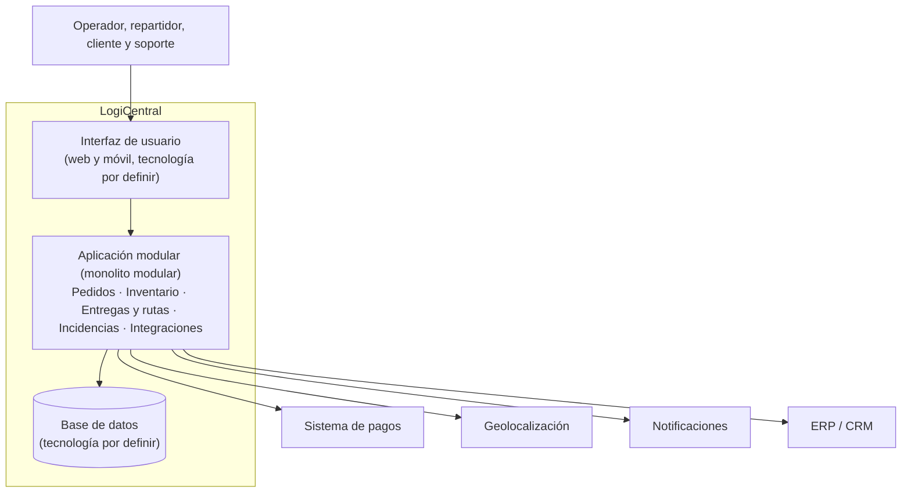
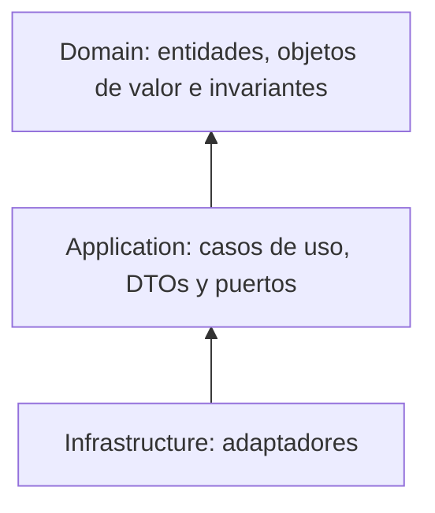

# Architecture.md — LogiCentral

Documento de arquitectura de la plataforma de gestión logística de última milla. Resume la estructura, los límites y las decisiones vigentes.

## 1. Propósito y alcance

LogiCentral centraliza el registro de pedidos, la validación de inventario, la asignación de repartidores y rutas, el seguimiento de entregas y la gestión de incidencias. El alcance y los riesgos están en la Actividad 1.

## 2. Decisiones vigentes

| Decisión | Resumen | Documento |
|---|---|---|
| Estructura | Monolito modular con límites de dominio claros | `docs/actividad-2/ADR-001-estructura-plataforma.md` |
| Diseño del dominio | Tres capas, entidad que protege invariantes, puertos y adaptadores, contratos entre contextos | `docs/actividad-3/ADR-002-diseno-dominio-y-limites.md` |

## 3. Vista general (C4, nivel 2: contenedores)



Los niveles 1 y 3 están en `docs/actividad-3/07-diagrama-c4.md`.

## 4. Contextos delimitados

| Contexto | Responsabilidad |
|---|---|
| Pedidos | Registro de pedidos, duplicados, estado e historial |
| Inventario | Stock por almacén y validación de disponibilidad |
| Entregas y rutas | Asignación de repartidores y rutas; seguimiento de entregas |
| Incidencias y soporte | Entregas fallidas y reclamos |
| Integraciones y notificaciones | Pagos, geolocalización, notificaciones y ERP/CRM |

Detalle de relaciones y contratos: `docs/actividad-3/05-contextos-y-contratos.md`.

## 5. Capas y regla de dependencias



**Regla:** las dependencias apuntan hacia adentro. El dominio no conoce la aplicación ni la infraestructura; la aplicación solo conoce interfaces; la infraestructura implementa esas interfaces.

## 6. Estructura de carpetas propuesta

```
/src
  /Domain
  /Application
  /Infrastructure
/tests
/docs
  /actividad-1
  /actividad-2
  /actividad-3
Architecture.md
README.md
```

## 7. Reglas críticas (invariantes)

Las reglas del negocio viven en el dominio, dentro de la entidad `Delivery` y los objetos de valor. Para el flujo "asignar repartidor":

- una entrega tiene como máximo un repartidor activo,
- solo una entrega *Pendiente* puede recibir repartidor,
- no se asigna un repartidor no disponible ni saturado,
- toda entrega tiene dirección y ventana válidas,
- toda asignación queda registrada y genera un evento.

Lista completa y escenarios Dado-Cuando-Entonces: `docs/actividad-3/04-invariantes-y-escenarios.md`.

## 8. Puertos y adaptadores del flujo "asignar repartidor"

| Puerto | Adaptador previsto |
|---|---|
| `IDeliveryRepository` | Repositorio de base de datos (y versión en memoria para pruebas) |
| `ICourierAvailabilityPort` | Adaptador de geolocalización / disponibilidad |
| `IDeliveryEventPublisher` | Adaptador de notificaciones y registro |
| `IClock` | Reloj del sistema (reloj fijo en pruebas) |

Detalle: `docs/actividad-3/06-casos-de-uso-puertos-adaptadores.md`.

## 9. Cómo comprobar el diseño

| Verificación | Cómo se comprueba |
|---|---|
| El dominio no depende de infraestructura | Revisar que `/src/Domain` no importe librerías de base de datos, HTTP ni frameworks |
| Los casos de uso dependen de interfaces | Revisar que reciban sus dependencias por constructor y no creen clases de infraestructura |
| Las invariantes se cumplen | Ejecutar los escenarios EA-01 a EA-10 como pruebas del dominio y del flujo con adaptadores en memoria |
| Los contextos no se acoplan | Revisar que no haya acceso directo a datos ni clases de otro contexto |

## 10. Riesgos y puntos abiertos

- Concurrencia al asignar: dos asignaciones simultáneas podrían saturar a un repartidor (se resuelve en la Actividad 4).
- Términos ambiguos por confirmar con el negocio: disponible, ruta saturada, reasignación, entrega fallida.
- Tecnologías de interfaz y base de datos por definir.

## 11. Historial de decisiones

- ADR-001 (Actividad 2): monolito modular.
- ADR-002 (Actividad 3): diseño del dominio y límites del flujo "asignar repartidor".
