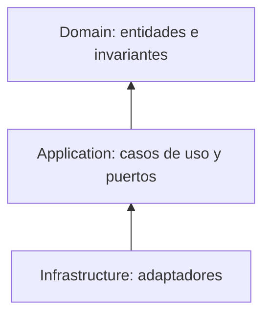

# LastMile

Plataforma de gestión logística de última milla para una empresa de retail digital.

## Resumen ejecutivo

- **Nombre del producto:** LastMile
- **Problema principal:** la empresa no tiene una vista única de sus pedidos: llegan por varios canales, el inventario está repartido en distintos lugares y las entregas se coordinan de forma manual. Esto genera pedidos duplicados, errores operativos y clientes que no saben dónde está su pedido.
- **Usuarios:** cliente, operador de tienda, administrador de almacén, repartidor y soporte al cliente.
- **Objetivo:** centralizar el registro de pedidos, la validación de inventario, la asignación de rutas y el seguimiento de entregas en un solo sistema.
- **Alcance:** el sistema se enfoca en la gestión de pedidos y entregas de última milla. No incluye campañas de marketing, contabilidad ni otros procesos administrativos de la empresa.

## Contenido del repositorio

- [`docs/actividad-1`](./docs/actividad-1) — análisis del problema, supuestos, decisiones iniciales, riesgos y diagrama de contexto de la Actividad 1.

## Materia

Fundamentos de Arquitectura de Software.

## Actividad 2: requisitos y decisión estructural

### Resumen del problema

La empresa de retail digital recibe pedidos por varios canales, tiene inventario distribuido y coordina entregas sin una vista centralizada. Esto genera pedidos duplicados, inconsistencias de inventario, entregas retrasadas y poca trazabilidad.

### Requisitos prioritarios

1. **Consistencia de inventario (RNF-05):** no confirmar pedidos sobre stock que no existe.
2. **Trazabilidad (RNF-04):** cada cambio de estado de un pedido queda registrado.
3. **Facilidad de evolución (RNF-06):** cambiar reglas de negocio sin reescribir todo el sistema.
4. **Disponibilidad (RNF-02):** 99,5 % en horario operativo.
5. **Seguridad (RNF-03):** datos sensibles cifrados y acceso por rol.

### Decisión arquitectónica

Se elige un **monolito modular con límites de dominio claros** (Pedidos, Inventario, Entregas y rutas, Incidencias y soporte, Integraciones y notificaciones), frente a una arquitectura de servicios distribuidos. Reduce costo, complejidad y riesgo operativo, facilita la consistencia de inventario y la trazabilidad, y deja abierta la posibilidad de separar módulos si el crecimiento lo justifica.

### Documentos

- [Catálogo de requisitos](./docs/actividad-2/01-catalogo-requisitos.md)
- [Matriz de priorización](./docs/actividad-2/02-matriz-priorizacion.md)
- [Escenarios de calidad](./docs/actividad-2/03-escenarios-calidad.md)
- [Comparación de alternativas](./docs/actividad-2/04-comparacion-alternativas.md)
- [ADR-001: estructura de la plataforma](./docs/actividad-2/ADR-001-estructura-plataforma.md)
- [Criterios verificables](./docs/actividad-2/05-criterios-verificables.md)
### Video de sustentación

[Ver video de la Actividad 2](https://youtu.be/a2_YGmJpnn0)

## Actividad 3: diseño y dominio

### Flujo diseñado

**Asignar un repartidor a una entrega**: una entrega confirmada debe quedar a cargo de exactamente un repartidor disponible y con capacidad, y el resultado debe informarse al resto del sistema.

### Propuesta

- **Modelo de dominio:** la entidad `Delivery` protege las reglas del negocio (un solo repartidor, estado *Pendiente*, repartidor disponible y no saturado). Los datos se describen con objetos de valor (`DeliveryAddress`, `DeliveryWindow`, `CourierAvailability`).
- **Tres capas:** Dominio, Aplicación e Infraestructura, con dependencias hacia adentro.
- **Puertos y adaptadores:** el caso de uso `AssignCourierUseCase` depende de interfaces (`IDeliveryRepository`, `ICourierAvailabilityPort`, `IDeliveryEventPublisher`); la infraestructura las implementa.
- **Contextos:** Pedidos, Entregas y rutas e Integraciones se comunican por eventos y referencias por identificador.

### Documentos

- [Architecture.md](./Architecture.md)
- [Flujo de negocio](./docs/actividad-3/01-flujo-negocio.md)
- [Glosario de lenguaje ubicuo](./docs/actividad-3/02-glosario-lenguaje-ubicuo.md)
- [Modelo de dominio](./docs/actividad-3/03-modelo-dominio.md)
- [Invariantes y escenarios de aceptación](./docs/actividad-3/04-invariantes-y-escenarios.md)
- [Contextos y contratos](./docs/actividad-3/05-contextos-y-contratos.md)
- [Casos de uso, puertos y adaptadores](./docs/actividad-3/06-casos-de-uso-puertos-adaptadores.md)
- [Diagrama C4](./docs/actividad-3/07-diagrama-c4.md)
- [ADR-002: diseño del dominio y límites](./docs/actividad-3/ADR-002-diseno-dominio-y-limites.md)

### Video de sustentación

[Ver video de la Actividad 3]()