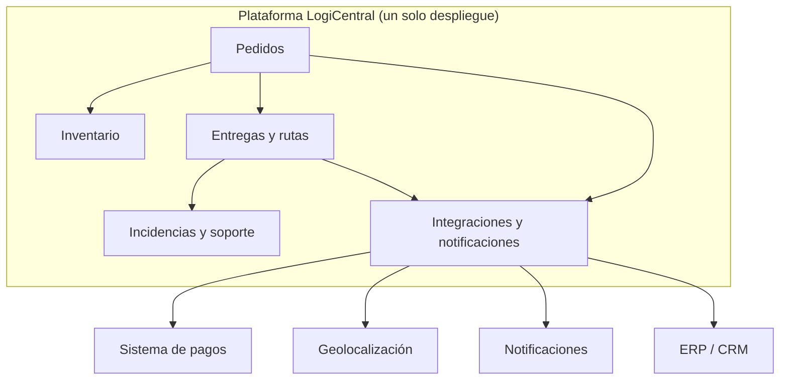

# ADR-001: Estructura de la plataforma logística

- **Estado:** Aceptada
- **Fecha:** 2026-10-12
- **Proyecto:** LogiCentral — plataforma de gestión logística de última milla

## Contexto

La empresa recibe pedidos por varios canales, maneja inventario distribuido y coordina entregas sin una vista centralizada. Esto genera duplicación, retrasos y poca trazabilidad (Actividad 1).

Los requisitos que más influyen en la estructura (ver `02-matriz-priorizacion.md`) son:

- consistencia de inventario (RNF-05),
- trazabilidad (RNF-04),
- facilidad de evolución (RNF-06),
- disponibilidad (RNF-02),
- seguridad (RNF-03).

Además, se asume un equipo y un presupuesto limitados y una operación con crecimiento moderado.

## Decisión

Se adopta un **monolito modular con límites de dominio claros**: un solo sistema desplegable, organizado en cinco módulos.

Reglas de la decisión:

1. Cada dominio es un módulo separado con responsabilidades propias.
2. Los módulos se comunican solo mediante interfaces públicas; ninguno accede directamente a los datos de otro.
3. Todas las integraciones externas pasan por el módulo de Integraciones, detrás de adaptadores con contrato documentado.
4. No se eligen tecnologías en esta decisión; eso corresponde a las siguientes unidades.

## Alternativas consideradas

| Alternativa | Resumen | Puntaje (ver `04-comparacion-alternativas.md`) |
|---|---|---|
| A. Monolito modular con límites claros | Un despliegue, varios módulos de dominio | 4,20 — **elegida** |
| B. Servicios distribuidos por dominio | Un servicio y datos propios por dominio | 2,60 — descartada por ahora |

## Justificación

- **Consistencia de inventario y trazabilidad:** con pedidos e inventario en un mismo sistema, validar stock y registrar el historial es más directo y confiable (ES-02, ES-07). Esto ataca los riesgos principales de la Actividad 1.
- **Costo y rapidez:** un solo despliegue requiere menos infraestructura y menos coordinación, adecuado para un equipo pequeño.
- **Riesgo operativo menor:** hay menos piezas que monitorear y que pueden fallar.
- **Evolución posible:** los límites entre módulos permiten separar uno como servicio más adelante si hay evidencia de que se necesita.
- **Evitar sobrediseño:** los microservicios agregarían complejidad antes de que el negocio demuestre que los necesita.

## Consecuencias

**Positivas**
- Construcción más rápida y barata.
- Consistencia de inventario y trazabilidad más sencillas de lograr.
- Operación y monitoreo simples.

**Negativas / trade-offs aceptados**
- Se escala el sistema completo, no cada módulo por separado.
- Una falla grave puede afectar a todos los módulos.
- Un despliegue único implica que los cambios de un módulo se publican junto con los demás.
- Se cambia flexibilidad futura por simplicidad presente.

## Riesgos y mitigaciones

| Riesgo | Mitigación |
|---|---|
| Los módulos se acoplan con el tiempo y el sistema se enreda | Revisar dependencias entre módulos; prohibir el acceso directo a datos de otro módulo |
| El volumen supera la capacidad del despliegue único | Monitorear la carga; usar los criterios de reevaluación de abajo |
| Una falla externa afecta a todo el sistema | Aislar integraciones con adaptadores y reintentos (ES-04) |
| Separar un módulo después resulta costoso | Mantener contratos claros entre módulos desde el inicio |

## Criterios de reevaluación

Esta decisión se revisa si ocurre alguna de estas situaciones:

- el volumen sostenido supera los 3.000 pedidos por hora,
- un módulo necesita escalar de forma independiente del resto,
- más de tres equipos trabajan en paralelo y se bloquean entre sí,
- los despliegues de un módulo afectan con frecuencia a los demás,
- los límites entre módulos se rompen de forma repetida.

## Referencias

- `01-catalogo-requisitos.md`
- `02-matriz-priorizacion.md`
- `03-escenarios-calidad.md`
- `04-comparacion-alternativas.md`
- `05-criterios-verificables.md`
