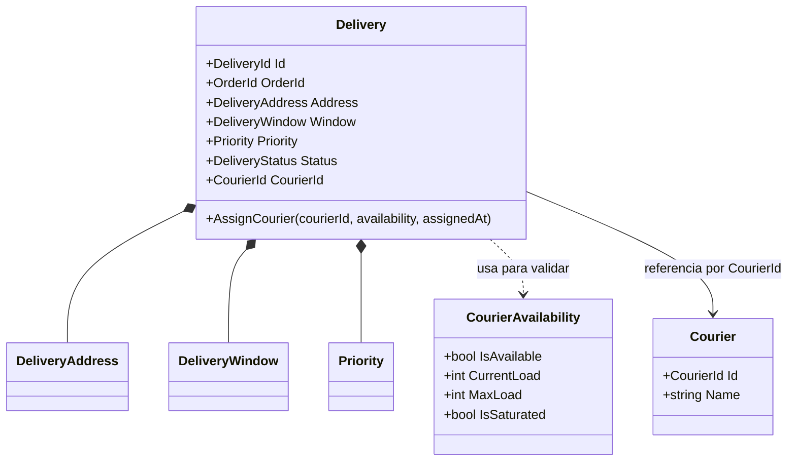
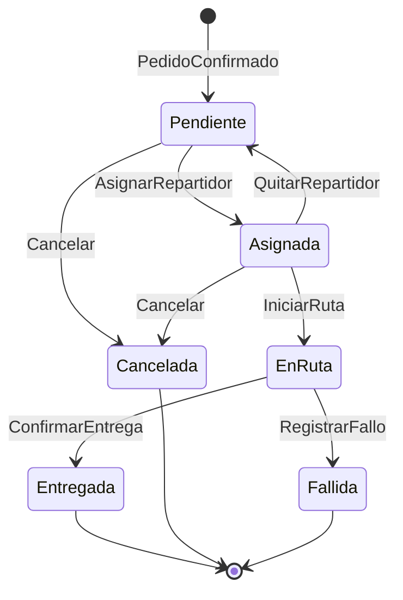

# Modelo de dominio — Actividad 3

Contexto: **Entregas y rutas**, módulo del monolito modular definido en el ADR-001.

## Agregado principal

El agregado **`Delivery`** (Entrega) es la raíz: concentra los datos de la entrega y protege sus reglas. Nadie cambia su estado o su repartidor sin pasar por sus métodos.

## Entidades

| Entidad | Identidad | Responsabilidad |
|---|---|---|
| `Delivery` (raíz) | `DeliveryId` | Mantener su estado y su repartidor; proteger las invariantes de la asignación |
| `Courier` | `CourierId` | Representar al repartidor; en este flujo solo importa su identidad |

La entrega referencia al pedido y al repartidor **solo por su identificador** (`OrderId`, `CourierId`), no por el objeto completo.

## Objetos de valor

| Objeto de valor | Atributos | Regla propia |
|---|---|---|
| `DeliveryAddress` | texto de la dirección | No puede estar vacía |
| `DeliveryWindow` | inicio, fin | El inicio es anterior al fin |
| `Priority` | normal / urgente | Solo valores permitidos |
| `CourierAvailability` | disponible, carga actual, capacidad | `IsSaturated` es verdadero si la carga actual alcanza la capacidad |
| `DeliveryStatus` | estado | Solo los seis estados definidos |

Los objetos de valor son inmutables: si algo cambia, se reemplaza por otro.

## Diagrama de entidades y relaciones

## Estados y transiciones de la entrega

| Desde | Evento | Hacia | ¿Se diseña en esta actividad? |
|---|---|---|---|
| (nuevo) | PedidoConfirmado | Pendiente | Solo se menciona (lo hace el contexto de Pedidos) |
| Pendiente | AsignarRepartidor | Asignada | **Sí, es el flujo central** |
| Pendiente / Asignada | Cancelar | Cancelada | No |
| Asignada | QuitarRepartidor | Pendiente | No (reasignación por confirmar) |
| Asignada | IniciarRuta | En ruta | No |
| En ruta | ConfirmarEntrega | Entregada | No |
| En ruta | RegistrarFallo | Fallida | No (se conectará con Incidencias) |

La máquina de estados vive **dentro del dominio** (la entidad decide qué transiciones son válidas). No se usa una máquina de estados de interfaz (video 25) porque este flujo no tiene estados de pantalla que controlar.

## Qué NO pertenece al dominio

Bases de datos, llamadas HTTP, formato JSON, envío de notificaciones, frameworks y cualquier detalle técnico. Todo eso va en infraestructura y se conecta mediante puertos.
