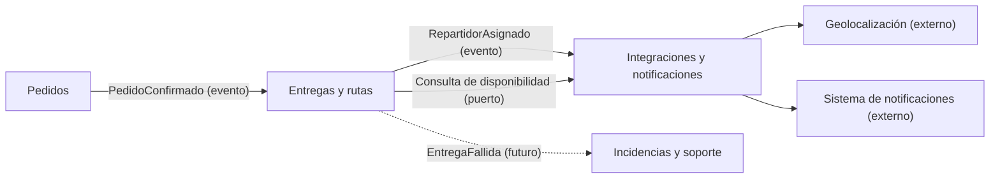

# Contextos delimitados y contratos — Actividad 3

Cada contexto delimitado (bounded context) es un módulo del monolito modular del ADR-001, con su propio modelo y su propio vocabulario.

## Contextos y responsabilidades

| Contexto | Responsabilidad | ¿Participa en este flujo? |
|---|---|---|
| Pedidos | Registrar pedidos, detectar duplicados, estado e historial del pedido | Sí: origina la entrega al confirmar un pedido |
| Inventario | Stock por almacén y validación de disponibilidad | No directamente (el stock se validó antes de confirmar el pedido) |
| **Entregas y rutas** | **Asignar repartidores, rutas y dar seguimiento a la entrega** | **Sí: es el contexto central del flujo** |
| Incidencias y soporte | Entregas fallidas y reclamos | No ahora; recibirá `EntregaFallida` en el futuro |
| Integraciones y notificaciones | Conexión con geolocalización, notificaciones, pagos y ERP/CRM | Sí: informa disponibilidad y envía avisos |

Una misma palabra puede significar cosas distintas según el contexto. Por ejemplo, **Pedido** en Pedidos incluye líneas, precios y pago, pero en Entregas y rutas solo es un identificador (`OrderId`).

## Mapa de contextos

## Relaciones entre contextos

| Relación | Tipo | Cómo se protege cada modelo |
|---|---|---|
| Pedidos → Entregas y rutas | Proveedor (upstream) → consumidor (downstream), con lenguaje publicado | Pedidos publica un evento con datos mínimos; Entregas crea su propia entrega y no conoce el modelo interno de Pedidos |
| Entregas y rutas → Integraciones | Capa anticorrupción | Los adaptadores traducen los datos del servicio externo al objeto `CourierAvailability` del dominio |
| Entregas y rutas → Incidencias | Evento (futuro) | Incidencias reacciona al evento sin modificar entregas |

## Contratos que se intercambian

| Contrato | De → A | Tipo | Datos |
|---|---|---|---|
| `PedidoConfirmado` | Pedidos → Entregas y rutas | Evento | `orderId`, dirección, ventana de entrega, prioridad |
| `RepartidorAsignado` | Entregas y rutas → Integraciones y notificaciones | Evento | `deliveryId`, `courierId`, fecha y hora de asignación |
| `ObtenerDisponibilidad` | Entregas y rutas → Integraciones | Consulta | Entrada: `courierId`, ventana de entrega. Salida: disponible (sí/no), carga actual, capacidad |
| `EntregaFallida` | Entregas y rutas → Incidencias | Evento (futuro) | `deliveryId`, motivo |

## Reglas entre contextos

1. Los contextos se referencian **solo por identificador** (`OrderId`, `CourierId`), nunca por objetos completos.
2. Un contexto **no lee ni escribe** en las tablas de otro.
3. Un contexto **no importa** las clases del dominio de otro; solo usa sus contratos.
4. Los datos externos entran al dominio **traducidos** por un adaptador.
5. Dentro del monolito, los eventos se entregan en el mismo proceso; si un módulo se separa en el futuro, el contrato no cambia.
