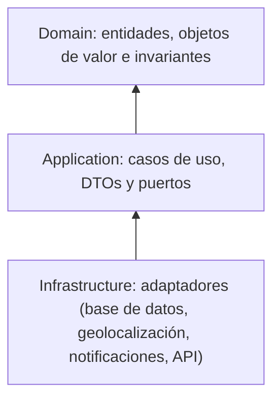
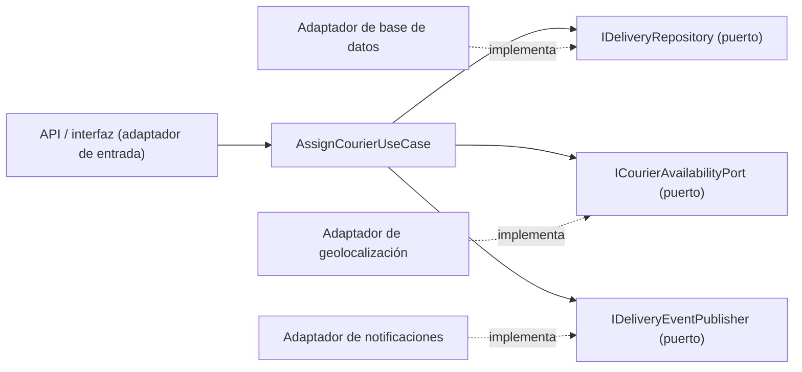

# Casos de uso, puertos y adaptadores — Actividad 3

## Capas y dirección de las dependencias

El sistema usa **tres capas**: Dominio, Aplicación e Infraestructura. Las dependencias apuntan siempre hacia adentro: el dominio no depende de nadie.



En el diagrama, cada flecha significa "depende de". La infraestructura depende de la aplicación (implementa sus puertos) y la aplicación depende del dominio. **Nunca al revés.**

| Capa | Contiene | No debe contener |
|---|---|---|
| Domain | Entidades, objetos de valor, invariantes | Base de datos, HTTP, frameworks |
| Application | Casos de uso, contratos (DTOs), puertos | Detalles de base de datos o HTTP |
| Infrastructure | Repositorios, APIs externas, notificaciones, controladores | Reglas del negocio |

## Casos de uso

| Caso de uso | Intención | ¿Se diseña ahora? |
|---|---|---|
| `AssignCourierUseCase` | Asignar un repartidor a una entrega | **Sí, en detalle** |
| `GetDeliveryStatusUseCase` | Consultar el estado de una entrega | Solo se menciona |
| `UnassignCourierUseCase` | Quitar o reasignar el repartidor | Solo se menciona (por confirmar) |
| `RegisterFailedDeliveryUseCase` | Registrar una entrega fallida | Solo se menciona |

## Caso de uso: AssignCourierUseCase

### Pasos

1. Cargar la entrega con `IDeliveryRepository`.
2. Verificar que la entrega exista.
3. Consultar la disponibilidad del repartidor con `ICourierAvailabilityPort` (un puerto, no una API concreta).
4. Ejecutar `delivery.AssignCourier(...)`: la entidad protege las invariantes.
5. Guardar con el repositorio.
6. Publicar el resultado con `IDeliveryEventPublisher`.

### Contrato de aplicación

| Elemento | Campos |
|---|---|
| **Entrada** `AssignCourierCommand` | `DeliveryId`, `CourierId` |
| **Salida** `AssignCourierResult` | `DeliveryId`, `CourierId`, `Status`, `AssignedAt` |

| Error | Cuándo ocurre |
|---|---|
| `DeliveryNotFoundException` | La entrega no existe |
| `DeliveryNotAssignableException` | La entrega ya tiene repartidor o no está *Pendiente* |
| `CourierNotAvailableException` | El repartidor no está disponible |
| `CourierSaturatedException` | El repartidor alcanzó su capacidad |
| `AvailabilityUnavailableException` | El servicio de disponibilidad no responde (error temporal) |

### Código ilustrativo

Solo ilustra la separación entre capas; no se implementa en esta actividad.

```csharp
// Application: contratos y puertos
public sealed record AssignCourierCommand(DeliveryId DeliveryId, CourierId CourierId);
public sealed record AssignCourierResult(DeliveryId DeliveryId, CourierId CourierId,
                                         DeliveryStatus Status, DateTimeOffset AssignedAt);

public interface IDeliveryRepository
{
    Task<Delivery?> GetAsync(DeliveryId id);
    Task SaveAsync(Delivery delivery);
}

public interface ICourierAvailabilityPort
{
    Task<CourierAvailability> GetAsync(CourierId courierId, DeliveryWindow window);
}

public interface IDeliveryEventPublisher
{
    Task PublishAsync(CourierAssigned assignedEvent);
}

public interface IClock
{
    DateTimeOffset Now();
}

// Application: caso de uso (recibe sus dependencias por constructor)
public sealed class AssignCourierUseCase
{
    private readonly IDeliveryRepository _deliveries;
    private readonly ICourierAvailabilityPort _availability;
    private readonly IDeliveryEventPublisher _publisher;
    private readonly IClock _clock;

    public AssignCourierUseCase(IDeliveryRepository deliveries,
        ICourierAvailabilityPort availability,
        IDeliveryEventPublisher publisher,
        IClock clock)
    {
        _deliveries = deliveries;
        _availability = availability;
        _publisher = publisher;
        _clock = clock;
    }

    public async Task<AssignCourierResult> ExecuteAsync(AssignCourierCommand command)
    {
        var delivery = await _deliveries.GetAsync(command.DeliveryId)
            ?? throw new DeliveryNotFoundException(command.DeliveryId);

        var availability = await _availability.GetAsync(command.CourierId, delivery.Window);

        delivery.AssignCourier(command.CourierId, availability, _clock.Now());

        await _deliveries.SaveAsync(delivery);
        await _publisher.PublishAsync(new CourierAssigned(delivery.Id, command.CourierId, _clock.Now()));

        return new AssignCourierResult(delivery.Id, command.CourierId, delivery.Status, _clock.Now());
    }
}
```

La entidad `Delivery.AssignCourier(courierId, availability, assignedAt)` es la que verifica INV-01 a INV-04 y INV-06. El caso de uso solo coordina.

## Puertos

| Puerto | Tipo | Qué necesita el caso de uso | Lo implementa |
|---|---|---|---|
| `IDeliveryRepository` | Salida | Cargar y guardar entregas | Adaptador de base de datos |
| `ICourierAvailabilityPort` | Salida | Saber si el repartidor está disponible y su carga | Adaptador de geolocalización / disponibilidad |
| `IDeliveryEventPublisher` | Salida | Informar que hubo una asignación | Adaptador de notificaciones y registro |
| `IClock` | Salida | Obtener la fecha y hora actual | Adaptador del reloj del sistema (en pruebas, un reloj fijo) |
| `AssignCourierUseCase` | Entrada | Recibir la petición de asignar | Lo invoca el controlador / API |

## Adaptadores

| Adaptador | Lado | Implementa o invoca | Detalle técnico que aísla |
|---|---|---|---|
| Controlador / API | Entrada | Invoca el caso de uso | HTTP, formato de datos |
| Repositorio de base de datos | Salida | `IDeliveryRepository` | Base de datos y su esquema |
| Adaptador en memoria | Salida | `IDeliveryRepository` | Para pruebas, sin base de datos |
| Adaptador de geolocalización | Salida | `ICourierAvailabilityPort` | API del proveedor externo (capa anticorrupción) |
| Adaptador de notificaciones | Salida | `IDeliveryEventPublisher` | Sistema de notificaciones externo |

## Puertos y adaptadores en el flujo



## Estructura de carpetas propuesta

```
/src
  /Domain          Delivery, DeliveryAddress, DeliveryWindow, Priority, CourierAvailability
  /Application     AssignCourierUseCase, comandos y resultados, puertos
  /Infrastructure  repositorios, adaptadores de geolocalización y notificaciones, API
/tests             pruebas del dominio y del flujo con adaptadores en memoria
```

## Cómo se evita acoplar el negocio a la infraestructura

- El dominio no referencia ninguna librería de base de datos ni HTTP.
- El caso de uso solo conoce interfaces y las recibe por constructor.
- Las reglas críticas están en la entidad, no en el caso de uso ni en los adaptadores.
- Para las pruebas se sustituyen los adaptadores por versiones en memoria.
