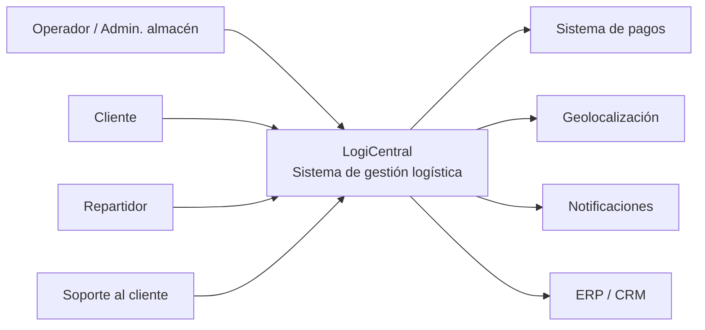
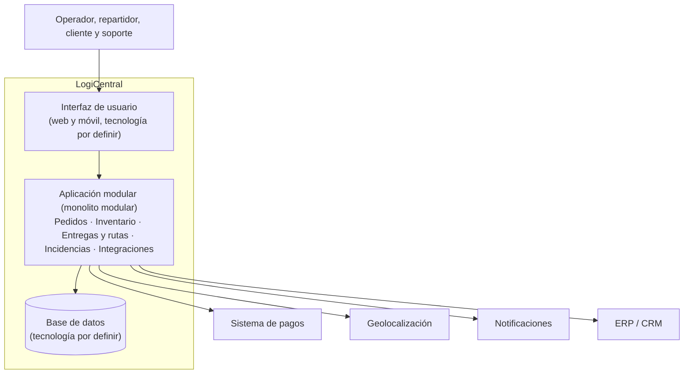
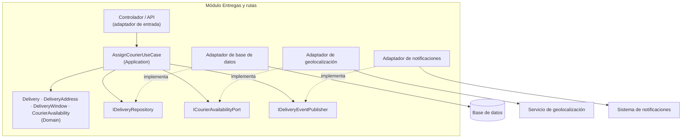

# Diagrama C4 actualizado — Actividad 3

El modelo C4 muestra la arquitectura en niveles: contexto, contenedores y componentes. Se actualiza respecto a la Actividad 1 (contexto) y la Actividad 2 (monolito modular).

## Nivel 1: contexto del sistema

## Nivel 2: contenedores

Se mantiene un solo despliegue (ADR-001). Las tecnologías se eligen en las siguientes actividades.

## Nivel 3: componentes del módulo Entregas y rutas

Además de estos puertos, el caso de uso usa un puerto de reloj (`IClock`) para poder probar el tiempo sin depender del reloj real.

## Cómo leer los diagramas

- **Nivel 1:** quién usa el sistema y con qué sistemas externos se conecta.
- **Nivel 2:** de qué piezas desplegables se compone el sistema.
- **Nivel 3:** cómo está organizado por dentro el módulo central del flujo, con las dependencias dirigidas hacia el dominio.
